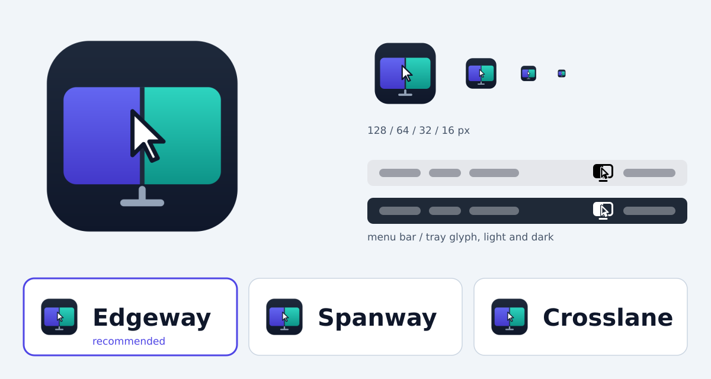

# Name and logo (proposal)

Status: proposal. The logo is ready to use; the name needs the owner's decision. Nothing in
the app uses these files yet (see "Using it" below).

## Logo

**Idea.** One screen shared by two computers: the left half is one machine, the right half the
other, and the pointer crosses the seam between them — the moment the product is about. The
two halves are deliberately not Apple's or Microsoft's shapes or colours (no apple, no four
panes, no Windows blue).

| File | Use |
|---|---|
| `icon.svg` | App icon (macOS icon grid: 824 px body in a 1024 px canvas). Readable down to 16 px. |
| `glyph.svg` | Monochrome glyph for the macOS menu bar (template image: black on transparent) and small monochrome uses. 18 x 18 pt. |
| `alt-hop.svg` | Alternative direction: two screens and a dotted hop. Clear when large, muddy at 32 px and below, so not recommended for the tray. |
| `preview.png` | Rendered sizes, the glyph on light and dark menu bars, name candidates. |

Colours

| | Hex |
|---|---|
| Left half (indigo) | `#6366F1` -> `#4338CA` |
| Right half (teal) | `#2DD4BF` -> `#0D9488` |
| Background (navy) | `#1E293B` -> `#0F172A` |
| Stand | `#94A3B8` |
| Pointer | `#FFFFFF`, outline `#0F172A` |

## Name

Recommended: **Edgeway**, "the way across the edge". You push the pointer over the screen
edge onto the other computer, and the logo shows exactly that. It is short, easy to say in
English and Russian («Эджвей») and works as a command (`edgeway pair --code 123456`).

Why not keep "macwin": Apple allows "Mac" in third-party product names under conditions,
but Microsoft's trademark guidelines say not to use its brand assets in product names, and
"Win" reads as Windows. Microsoft sued Lindows over a similar name; Lindows was renamed
Linspire in a 2004 settlement.

Candidates checked on crates.io, GitHub and the web on 2026-10-14 (trademark registers were
not searched):

| Name | Verdict |
|---|---|
| Edgeway | Low risk: crate name free, no KVM or networking product found; a small unrelated app maker (Edgeway Software); `.com` taken. |
| Spanway | Low risk: crate name free, no software product found. |
| Crosslane | Low risk: crate name free, only indie games and a consultancy. |
| Hopover, Edgehop, Tandem | Rejected: projects of the same kind exist (Hopover: a Mac/Windows KVM with code pairing, published 2026-10-12). |
| Ferry, Causeway, Crossway, Mostik | Rejected: notable products with the name (file transfer and remote desktop; mTLS tunnels and Apache Causeway; ESV Bible apps; an AI startup). |

Renaming would change what users see: app and binary names, tray titles, packages, README.
What existing installations depend on (config and cache directories, the keychain item, the
bundle identifier, the LaunchAgent label, the Run value) needs a one-time migration, or it can
keep the old internal names. Protocol identifiers (ALPN `macwin/1`, discovery magic `MWD1`)
are invisible to users and should stay until a protocol version change.

## Using it (after the name is decided)

- macOS: `AppIcon.icns` built from `icon.svg` (`iconutil`) and `CFBundleIconFile` in
  `Info.plist`; the menu bar item shows `glyph.svg` as a template image instead of the SF
  Symbols, with the state as a small badge.
- Windows: an `.ico` (16-256 px) embedded in `macwin.exe` and `macwin-tray.exe`; the tray
  icon is the small app icon with a state dot instead of the coloured circles.
